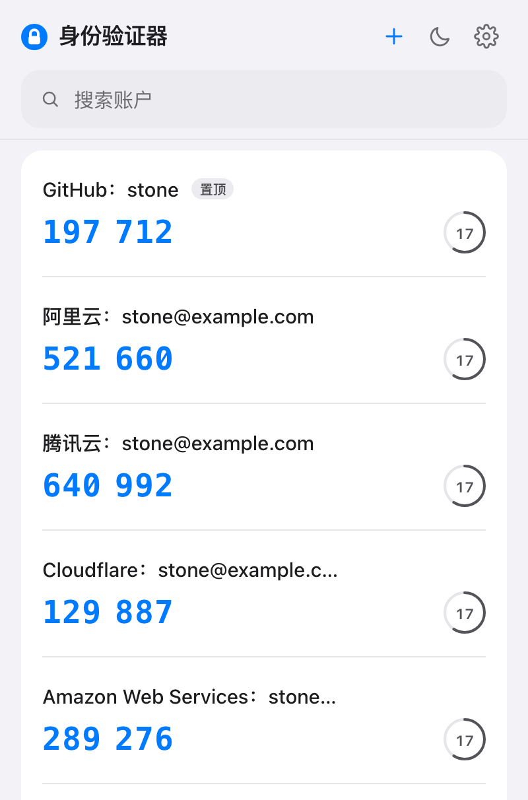
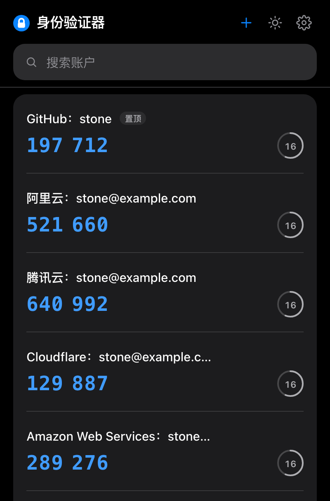
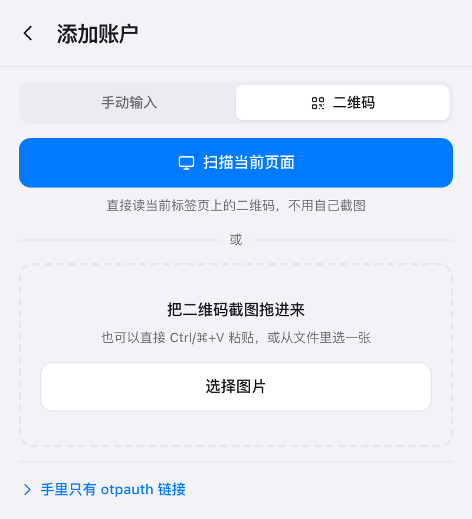
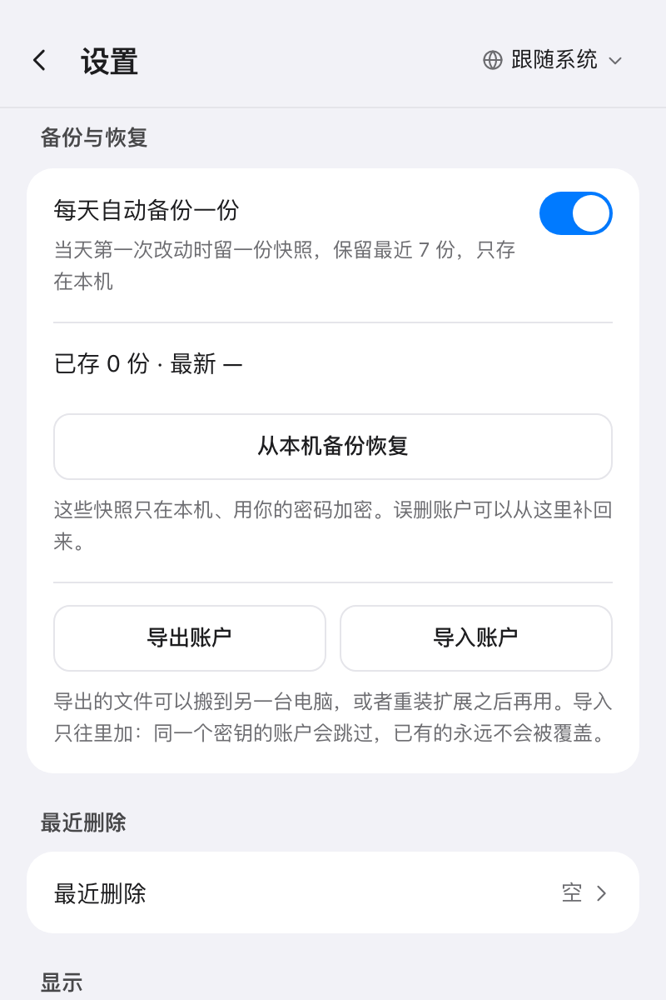

# Authenticator · Local TOTP

[中文](README.md) · **English**

[](LICENSE)
[](https://github.com/MrLeihe/Authenticator)
[](https://developer.chrome.com/docs/extensions/develop/migrate)
[](https://developer.chrome.com/docs/extensions/reference/api/storage)
[](#privacy)
[](src/core/__tests__)

> A TOTP two-factor authenticator browser extension with no network, no account and no cloud. Your secrets stay in your own browser.

## Why local-first

Most authenticators sell sync: secrets are encrypted, uploaded, and shared across devices. The price is that you have to trust that server, that account system, and that encryption implementation.

This extension goes the other way — **no server means no server to break into.** It is a Chrome popup, and everything lives in `chrome.storage.local`, always encrypted with AES-256-GCM. It requests no network permission, loads no remote code, ships no analytics, and contains zero `fetch` calls.

The trade-offs are stated up front rather than buried:

- **No cross-device sync.** Moving to a new machine means exporting and importing an encrypted file, not scanning a QR code
- **No autofill.** That would require `host_permissions` — i.e. handing over the ability to read any page
- **Not a password manager.** It stores TOTP secrets only — no passwords, no credentials beyond the recovery code

## Features

| | |
| --- | --- |
| **Algorithms** | TOTP / HOTP, SHA1 · SHA256 · SHA512, 6 and 8 digits |
| **Vault** | Optional password unlock, recovery-code reset, idle auto-lock, up to 7 local backups a day |
| **Accounts** | Manual entry, QR scan (upload / drop / paste / scan current page), edit, drag to sort, pin, 30-day trash |
| **Import / export** | Encrypted JSON, plaintext otpauth text, Google Authenticator migration payloads |
| **UI** | Chinese and English, light and dark themes, normal / compact list density, fully keyboard-driven, `aria` accessible |
| **Privacy** | No network, no telemetry, no account — only `storage` + `activeTab` |

A few things worth calling out:

- 244 unit assertions, including six official RFC 6238 vectors and ten from RFC 4226 Appendix D
- Codes are cached per `accountId → counter`: with 20 accounts, each 250 ms tick recomputes only the ones about to roll over; the rest hit the cache
- Import is additive only and decides **by secret first, then by name** — same secret is the same credential, and nothing is ever overwritten
- Plaintext export is an explicit choice with the consequences spelled out above the button; encrypted exports derive their own key, so an old backup still opens after a reinstall
- When the popup follows the system theme, switching the OS theme takes effect immediately — no reopen needed

Milestones P0–P7 are all done: scaffold → algorithms → main UI → vault → CRUD → import/export → polish.

## Screenshots

<table>
  <tr>
    <td align="center"></td>
    <td align="center"></td>
  </tr>
  <tr>
    <td align="center"></td>
    <td align="center"></td>
  </tr>
</table>

Captured from the current build. The accounts are synthetic fixtures injected by `?demo`, with secrets derived from a fixed seed — **not a single real account**.

## Install

For now, build it yourself:

```bash
pnpm install
pnpm build        # emits dist/
```

Then open `chrome://extensions`, enable Developer mode, click "Load unpacked", and **select `dist/` — not the repository root**.

> ⚠️ There is deliberately no `manifest.json` at the repo root; it is generated from `manifest.config.ts` at build time. Selecting the root fails with "Manifest file is missing or unreadable".

## Development

Requires Node.js 20+ and pnpm.

| Command | What it does |
| --- | --- |
| `pnpm dev` | Start the HMR dev server |
| `pnpm test` | Run the unit tests (244 assertions / 13 files) |
| `pnpm test:watch` | Watch mode |
| `pnpm typecheck` | Both TS projects must pass (`src` and the build config) |
| `pnpm build` | `typecheck` then emit `dist/` |
| `pnpm zip` | Package a distributable zip, with the third-party license text bundled in |
| `pnpm shots` | Re-capture the popup screenshots used in this README (needs `pnpm dev`) |

To iterate on styling without reloading the extension, open `http://localhost:5173/src/popup/index.html` directly — outside the extension the version label reads "dev preview".

`pnpm dev` keeps rewriting `dist/` (the HMR address is written into `service-worker-loader.js`), and that build only works while the dev server is alive. **Before loading a real build, stop the dev server, `rm -rf dist`, and run `pnpm build` again** — otherwise you get a blank page or a jump to localhost. Full details in [docs/DESIGN.md](docs/DESIGN.md#local-build-traps) (Chinese).

## Architecture

```
src/
├── core/        # Pure TS: no DOM, no chrome.*, 100% unit-testable
├── platform/    # The only layer allowed to touch chrome.*, kept mockable
├── background/  # MV3 service worker: registers events only, holds no state, runs no timers
├── popup/       # Popup entry point
└── ui/          # React components, screens, hooks, i18n
```

Three rules:

1. **`core/` knows neither `chrome` nor React.** All algorithms and data transforms live there, so tests need no browser environment.
2. **Only `platform/` calls `chrome.*`.** Everything else reaches storage and runtime through it.
3. **Timers belong to the UI layer.** An MV3 service worker is torn down after ~30 s idle; any timer-dependent state placed in the SW fails silently.

The per-file tree, the implementation trade-offs behind TOTP and the crypto, the permission boundaries, and the measured performance numbers are all in [docs/DESIGN.md](docs/DESIGN.md) (written in Chinese, the project's primary language).

## Privacy

- No network requests at all — no CDN, no remote code, no `eval`
- No data collection, no analytics, no user identification
- Secrets are only ever written to disk encrypted; with encryption on, no plaintext exists in memory while the vault is locked
- The unlocked session key lives only in `chrome.storage.session`, restricted to the extension's own pages, and disappears when the browser exits
- The clipboard is cleared automatically after copying, per your setting
- **Only when you press "Scan this page"** is one frame of the current tab captured to read a QR code locally; it stays in memory, is never written to disk or uploaded, and is discarded on failure

The full text is in the [privacy policy](docs/PRIVACY.md) (Chinese and English). Section 3 openly discloses the premise every local authenticator shares — while the browser process is alive and the vault is unlocked, anyone who can run the extension's pages can read the decrypted secrets.

## Permissions

| Permission | Purpose | Scope |
| --- | --- | --- |
| `storage` | Save the encrypted vault, settings, and automatic backups | Readable by the extension only |
| `activeTab` | One capture of the current tab for "Scan this page" | Not persistent; valid only for the active tab from the moment you open the popup; cannot read other tabs or history |

No `host_permissions` are requested, so there is no standing access to any website. `contextMenus` and `scripting` will be added only when the features that need them land — permissions you do not use leave users unable to judge whether to trust the extension.

## Documentation

| File | Contents |
| --- | --- |
| [README.md](README.md) | Chinese version of this document |
| [docs/DESIGN.md](docs/DESIGN.md) | Layer structure, design notes, crypto and backup model, performance data (Chinese) |
| [docs/PRIVACY.md](docs/PRIVACY.md) | Privacy policy (Chinese and English). The file here is the source; host a copy if you want to share a link |
| [docs/THIRD_PARTY_LICENSES.md](docs/THIRD_PARTY_LICENSES.md) | Full third-party license text (jsQR / Apache-2.0) |

## Contributing

- Run `pnpm test && pnpm typecheck` before committing
- All user-facing copy goes into the `ui/i18n.ts` dictionary (one Chinese and one English entry — omit one and it will not compile); components contain no full sentences
- The data layer (`core/` / `platform/`) emits reason codes only, never user-facing sentences in exceptions
- Tests use RFC public vectors or synthetic data only. **No real secret may ever appear in a commit**
- Any algorithm change must come with matching RFC vector assertions
- No UI component library: components are hand-written to control line height, letter spacing, and similar details precisely
- Icons and UI screenshots are generated by `scripts/`; do not hand-edit the outputs — change `make_icons.py` for icons, and run `pnpm shots` for popup screenshots

## References and credits

The algorithms follow RFC 4226 (HOTP) and RFC 6238 (TOTP); base32 follows RFC 4648.

Visual and interaction design took factual design data — colour values, type sizes, line heights, spacing — from existing authenticator products and implemented it independently; no third-party code or copy was reproduced. For code-level ideas, credit goes to the MIT-licensed [Authenticator-Extension](https://github.com/Authenticator-Extension/Authenticator).

[jsQR](https://github.com/cozmo/jsQR) (Apache-2.0) is bundled unmodified as a fallback for decoding QR images when the browser's built-in `BarcodeDetector` is unavailable. It is split into its own chunk and only loads when that fallback path is actually taken. Full license in [docs/THIRD_PARTY_LICENSES.md](docs/THIRD_PARTY_LICENSES.md).

## License

[MIT](LICENSE) © 2026 MrLeihe
