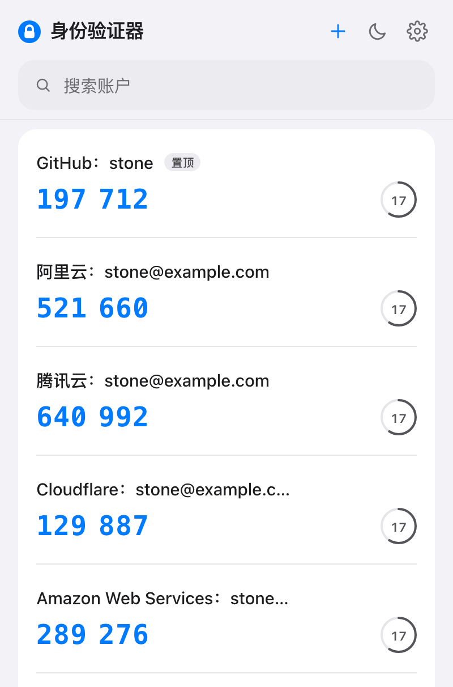
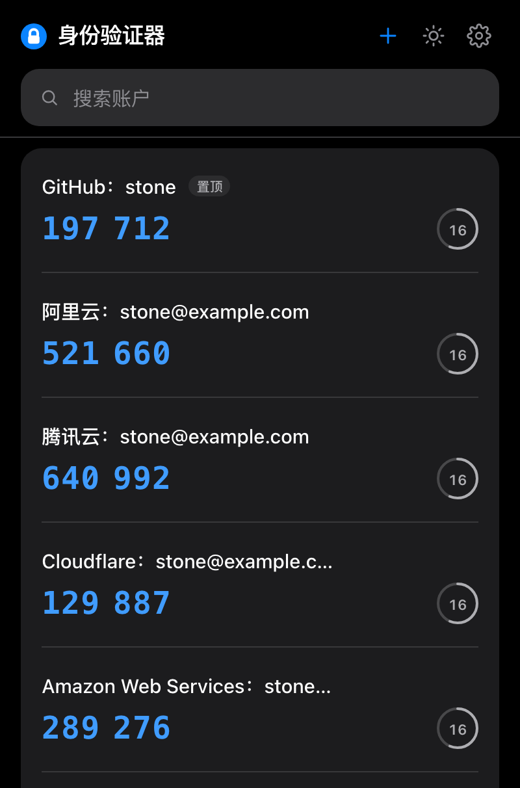
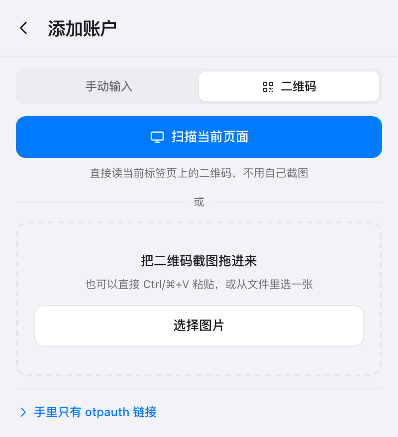
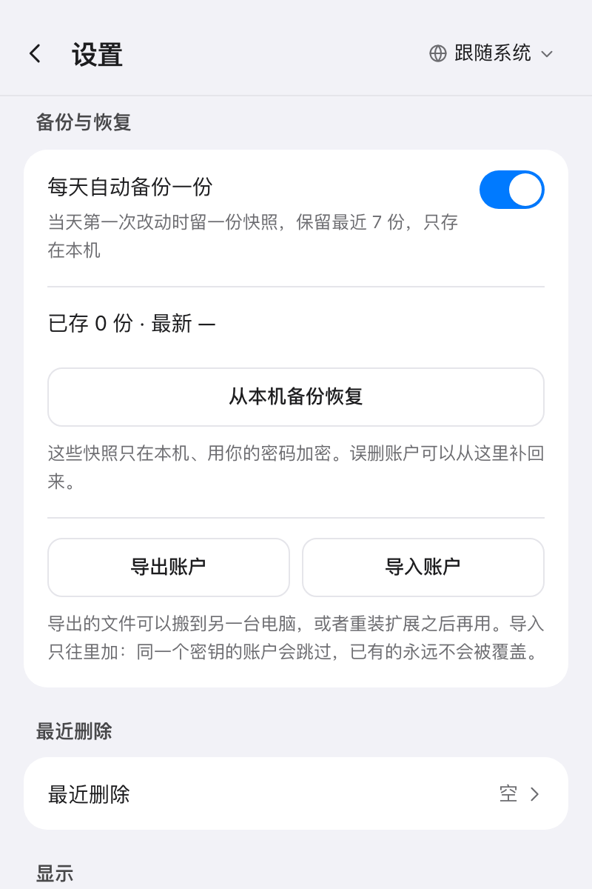

# 身份验证器 · 本地两步验证

**中文** · [English](README.en.md)

[](LICENSE)
[](https://github.com/MrLeihe/Authenticator)
[](https://developer.chrome.com/docs/extensions/develop/migrate)
[](https://developer.chrome.com/docs/extensions/reference/api/storage)
[](#隐私)
[](src/core/__tests__)

> 一个不联网、无账号、无云端的 TOTP 两步验证器浏览器扩展。密钥只存在你自己的浏览器里。

## 为什么是「本地优先」

多数两步验证器把「同步」当卖点：密钥加密后存进云端，多设备共享。代价是你必须相信那台服务器、那套账号体系，以及它的加密实现。

这个扩展走反方向——**没有服务器，就没有能被攻破的服务器。** 产品形态是一个 Chrome 弹窗，数据全部落在 `chrome.storage.local`，始终以 AES-256-GCM 密文保存。它不申请任何网络权限、不加载远程代码、不埋点，代码里没有一处 `fetch`。

愿意为这个取向付出的代价，也一并写在这里：

- **不跨设备同步。** 换电脑靠加密文件导出 / 导入，而不是扫码登录
- **不做自动填充。** 那需要 `host_permissions`，等于把读取任意页面的能力交出去
- **不是密码管理器。** 只存 TOTP 密钥，不存密码，不存除恢复码之外的任何凭据

## 功能

| | |
| --- | --- |
| **算法** | TOTP / HOTP，SHA1 · SHA256 · SHA512，6 位与 8 位 |
| **保险库** | 可选密码解锁、恢复码重设、空闲自动锁、每日最多 7 份本地备份 |
| **账户** | 手动添加、扫码（上传 / 拖放 / 粘贴 / 扫当前页）、编辑、拖拽排序、置顶、最近删除 30 天内可恢复 |
| **导入导出** | 加密 JSON、明文 otpauth 文本、Google Authenticator 迁移码 |
| **界面** | 中英双语、明暗双主题、正常 / 紧凑两档视图、键盘全可用、`aria` 无障碍 |
| **隐私** | 零网络、零遥测、零账号，只申请 `storage` + `activeTab` 两个权限 |

几处值得单独说的：

- 列表 244 个单元断言，含 RFC 6238 六组官方向量与 RFC 4226 附录 D 十组向量
- 验证码按 `accountId → counter` 缓存：20 个账户每 250ms 只重算即将翻页的那几个，同窗口内其余直接命中
- 导入只做加法：判定**先密钥后名字**，同密钥即同一条凭据，绝不覆盖已有账户
- 明文导出是显式选择，按钮上方就把后果写明；加密导出的密钥独立派生，重装后仍能打开旧备份
- 弹窗跟随系统主题时，系统切换立即生效，不需要重开

开发里程碑 P0–P7 已全部完成：脚手架 → 算法 → 主界面 → 保险库 → 增删改 → 导入导出 → 细节打磨。

## 截图

<table>
  <tr>
    <td align="center"></td>
    <td align="center"></td>
  </tr>
  <tr>
    <td align="center"></td>
    <td align="center"></td>
  </tr>
</table>

截图取自当前构建，账户是 `?demo` 注入的合成数据，密钥由固定种子生成，**没有一条真实账户**。

## 安装

目前只能从源码构建：

```bash
pnpm install
pnpm build        # 产出 dist/
```

然后打开 `chrome://extensions`，开启右上角的开发者模式，点「加载已解压的扩展程序」，**指向 `dist/`（不是仓库根目录）**。

> ⚠️ 仓库根目录故意没有 `manifest.json`——它由 `manifest.config.ts` 在构建期生成，选根目录会报「清单文件缺失或不可读取」。

## 开发

需要 Node.js 20+ 与 pnpm。

| 命令 | 作用 |
| --- | --- |
| `pnpm dev` | 启动 HMR 开发服务器 |
| `pnpm test` | 跑单元测试（244 断言 / 13 个文件） |
| `pnpm test:watch` | 测试监听模式 |
| `pnpm typecheck` | 两个 TS 工程都要过（`src` 与构建配置） |
| `pnpm build` | `typecheck` 后产出 `dist/` |
| `pnpm zip` | 打包成可分发的 zip，附上第三方许可文本 |
| `pnpm shots` | 重出 README 里的弹窗截图（需先 `pnpm dev`） |

想调样式又不想反复重载扩展，可以直接在浏览器打开 `http://localhost:5173/src/popup/index.html`，非扩展环境下版本号会显示为「开发预览」。

`dist/` 会被 `pnpm dev` 持续改写（HMR 地址写进 `service-worker-loader.js`），这版只有 dev server 活着时能用。**要装正式版先停掉 dev server，`rm -rf dist` 后重新 `pnpm build`**，否则装进去会白屏或跳向 localhost。完整说明见 [docs/DESIGN.md](docs/DESIGN.md#本地构建与-dev-陷阱)。

## 架构

```
src/
├── core/        # 纯 TS：零 DOM、零 chrome.*、100% 可单测
├── platform/    # 唯一允许碰 chrome.* 的一层，便于 mock
├── background/  # MV3 service worker：只注册事件，不持有状态、不做计时
├── popup/       # 弹窗入口
└── ui/          # React 组件、界面、hooks、i18n
```

三条纪律：

1. **`core/` 不认识 `chrome`，也不认识 React。** 算法与数据变换全部在这里，测试不需要任何浏览器环境。
2. **只有 `platform/` 能调用 `chrome.*`。** 其余代码通过它间接访问存储与运行时。
3. **计时只在 UI 层。** MV3 的 service worker 约 30 秒空闲即被回收，任何依赖定时器的状态放进 SW 都会静默失效。

逐文件目录树、TOTP 与加密的实现取舍、权限最小化的边界、性能实测数据，都在 [docs/DESIGN.md](docs/DESIGN.md)。

## 隐私

- 不发起任何网络请求，没有 CDN、没有远程代码、没有 `eval`
- 不收集数据，不埋点，不识别用户
- 密钥只以密文形式落盘；开启加密后，未解锁时内存里也不存在明文
- 解锁后的会话密钥只放在 `chrome.storage.session`，且收紧到只有扩展自己的页面可读；关浏览器即消失
- 复制验证码后按设置自动清空剪贴板
- **只有你主动点「扫描此页面」时**才截取当前标签页的一张画面，用于在本机识别二维码；截图只存在于内存，不落盘、不上传，失败即丢弃

完整条款见[隐私政策](docs/PRIVACY.md)（中英双语）。其中第 3 节主动披露了本地验证器共同的前提——浏览器进程存活且保险库处于解锁态时，能运行扩展页面的人就能读到解密后的密钥。

## 权限

| 权限 | 用途 | 边界 |
| --- | --- | --- |
| `storage` | 保存加密保险库、设置与自动备份 | 仅扩展自身可读 |
| `activeTab` | 「扫描此页面上的二维码」时截取当前标签页一张画面 | 不常驻；只在你点开扩展那一刻对当前这一个标签页有效，读不到其他标签页与历史 |

不申请 `host_permissions`，因此没有对任何网站的常驻访问权。`contextMenus`、`scripting` 等留到相关功能真正落地时再加——用不到的权限会让用户无从判断该不该信它。

## 文档

| 文件 | 内容 |
| --- | --- |
| [README.en.md](README.en.md) | 英文版说明 |
| [docs/DESIGN.md](docs/DESIGN.md) | 目录分层、设计要点、加密与备份方案、性能数据 |
| [docs/PRIVACY.md](docs/PRIVACY.md) | 隐私政策（中英双语）。仓库里的文件是源本，需要分享时建议托管一份 |
| [docs/THIRD_PARTY_LICENSES.md](docs/THIRD_PARTY_LICENSES.md) | 第三方许可全文（jsQR / Apache-2.0） |

## 参与开发

- 提交前跑 `pnpm test && pnpm typecheck`
- 界面文案只写进 `ui/i18n.ts` 的字典（中英各一份，少一句就编译不过）；组件里不出现成句的文字
- 数据层（`core/` / `platform/`）只报原因码，不要在异常里写面向用户的句子
- 测试只用 RFC 公开向量或合成的假数据，**提交里不能出现任何真实密钥**
- 算法改动必须同时补 RFC 向量断言，否则不如不改
- 不引入 UI 组件库：组件都是手写的，为的是精确控制行高、字距这类细节
- 图标与界面截图由 `scripts/` 生成，不要手工改产物：图标改 `make_icons.py`，弹窗截图跑 `pnpm shots`

## 参考与致谢

算法遵循 RFC 4226（HOTP）与 RFC 6238（TOTP），base32 遵循 RFC 4648。

视觉与交互参考了若干现有验证器产品的公开界面，只取色值、字号、行高、间距这类事实性设计数据自行实现，不复制任何第三方代码与文案。代码层面的思路参考了 MIT 协议的 [Authenticator-Extension](https://github.com/Authenticator-Extension/Authenticator)。

产物里原样打入了 [jsQR](https://github.com/cozmo/jsQR)（Apache-2.0），在浏览器没有内置 `BarcodeDetector` 时用它解码二维码图片，未作修改。它被拆成独立的 chunk，只有真走到兜底路径时才会加载。许可全文见 [docs/THIRD_PARTY_LICENSES.md](docs/THIRD_PARTY_LICENSES.md)。

## 许可

[MIT](LICENSE) © 2026 MrLeihe
